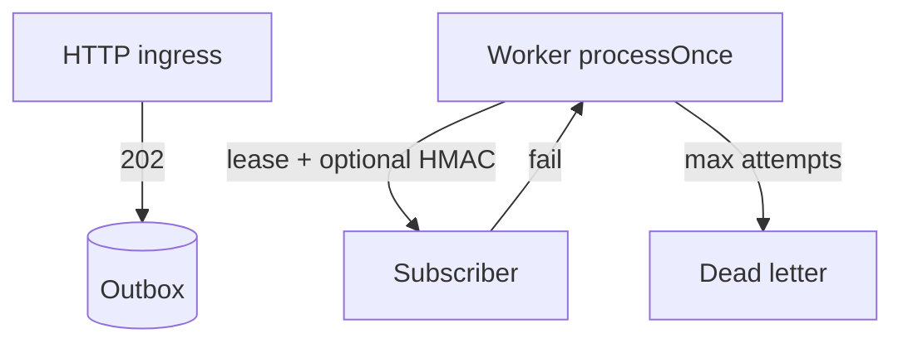

# webhook-relay — stop vanishing webhooks

[](https://github.com/marchikx/webhook-relay/actions/workflows/ci.yml)

**Who:** teams that emit or forward webhooks and cannot afford silent loss.  
**When:** after you’ve outgrown fire-and-forget `fetch` on the request thread.  
**Proof:** press “Fail a webhook” on https://marchikx.github.io/ops-hq-demo/ — same `OutboxStore` + `processOnce`.

Accept events with **202**, put them in an outbox, deliver with leases, exponential backoff, dead-letter, optional outbound HMAC, and lease fencing so a stale worker cannot corrupt status.

```bash
git clone https://github.com/marchikx/webhook-relay
cd webhook-relay && make verify
```

See `examples/express-relay.ts` for a 5-minute wiring sketch.

## Architecture



## Tradeoffs (honest)

| Choice | Why |
|--------|-----|
| Lease fencing on deliver/fail | Stale workers cannot flip status after reclaim |
| Optional `hmacSecret` on `processOnce` | Signed outbound when you need it |
| At-least-once delivery | Receivers must dedupe |
| `pg` as optional adapter surface | Memory store for tests; Postgres schema included |

MIT · Hire via https://github.com/marchikx/marchikx/issues/new?template=hire.md
