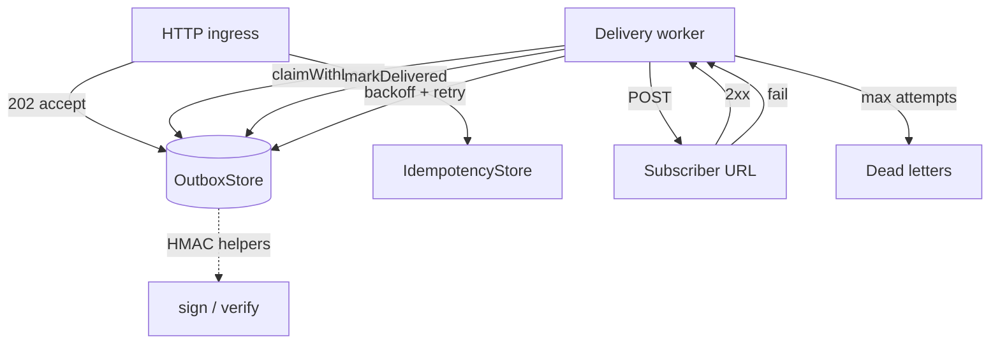

# webhook-relay

Transactional webhook **outbox** for Node.js: enqueue events, deliver over HTTP with worker leases, exponential backoff, a dead-letter queue (DLQ), HMAC signing helpers, and idempotency keys. Everything ships with in-memory stores so you can unit-test reliability logic without a database.

## Who it is for

Teams that accept webhooks or emit them to customers and need **at-least-once delivery** with safe retries—not fire-and-forget `fetch` from the request thread. Integrate the outbox in your API, run `processOnce` in a worker loop, and plug in Postgres or Redis adapters in production.

## Demo snippet

```typescript
import {
  OutboxStore,
  processOnce,
  IdempotencyStore,
  buildSignedPayload,
  signHmacSha256,
} from 'webhook-relay';

const outbox = new OutboxStore();
const idem = new IdempotencyStore();

app.post('/events', (req, res) => {
  const key = req.headers['idempotency-key'] as string;
  if (!idem.rememberKey(key, 86_400_000)) {
    res.status(409).json({ error: 'duplicate' });
    return;
  }
  outbox.enqueue({ targetUrl: 'https://customer.app/hooks', body: req.rawBody });
  res.status(202).json({ accepted: true });
});

setInterval(() => {
  void processOnce({
    store: outbox,
    workerId: 'relay-1',
    leaseMs: 60_000,
    fetch: globalThis.fetch,
  });
}, 5_000);
```

Signing an outbound body:

```typescript
const timestamp = String(Math.floor(Date.now() / 1000));
const nonce = crypto.randomUUID();
const payload = buildSignedPayload(rawBody, timestamp, nonce);
const signature = signHmacSha256(process.env.WEBHOOK_SECRET!, payload);
```

## Quick start

```bash
git clone https://github.com/marchikx/webhook-relay
cd webhook-relay
make verify
```

`make verify` runs `npm ci` and `npm run verify` (TypeScript check + Vitest). Expect exit code `0`.

## Architecture



## Decisions and tradeoffs

| Choice | Rationale |
|--------|-----------|
| In-memory default | Fast CI and pure unit tests; swap storage behind the same method shapes later. |
| Lease on claim | Prevents two workers from delivering the same message concurrently. |
| 5-minute base backoff, 12h cap | Limits load on a failing endpoint while guaranteeing eventual DLQ visibility. |
| `processOnce` not a long-running daemon | You control scheduling (cron, queue consumer, serverless tick). |
| HMAC over `timestamp.nonce.body` | Common signed-webhook pattern; constant-time compare on verify. |

## Tests

```bash
npm test
```

Coverage includes HMAC verify success and failure, backoff growth and cap, successful delivery, five failures leading to DLQ, and duplicate idempotency rejection.

## License

MIT — see [LICENSE](LICENSE).

## Hire / paid task

Need **production-grade webhook infrastructure** (Postgres outbox, metrics, multi-tenant signing keys, replay UI)? Open a GitHub issue with your volume and SLO targets, or mention “webhook relay hardening” — typical engagement: audit your current retry/DLQ behavior and deliver a hardened worker plus runbooks in one sprint.
